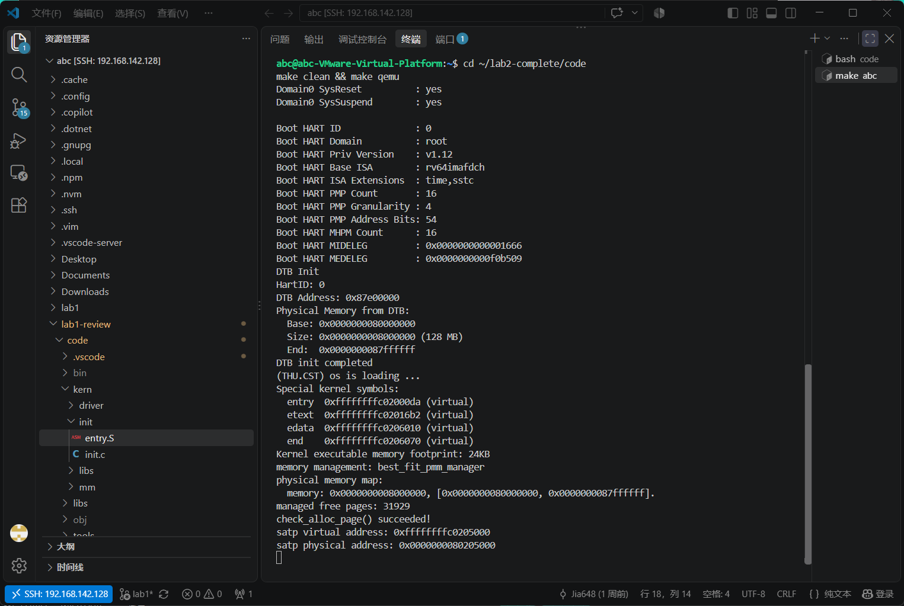
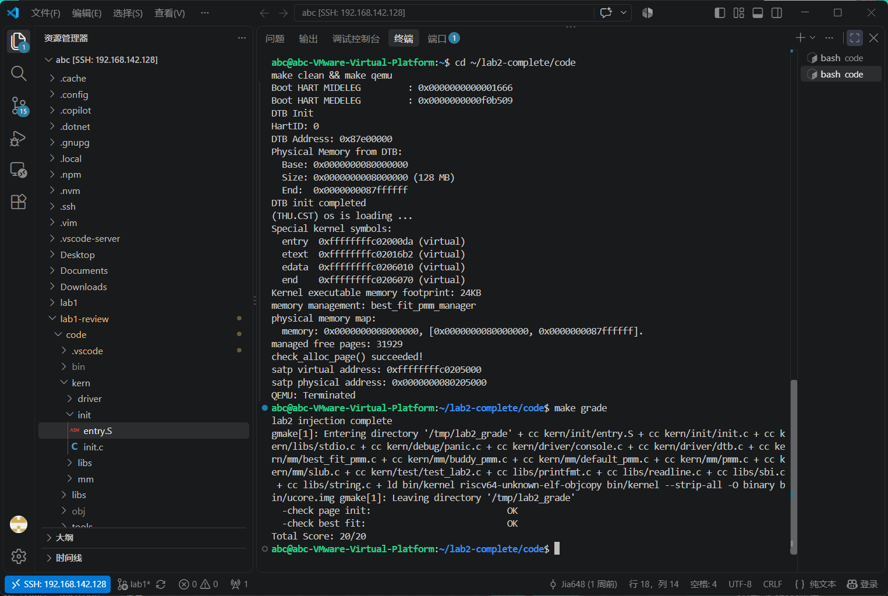
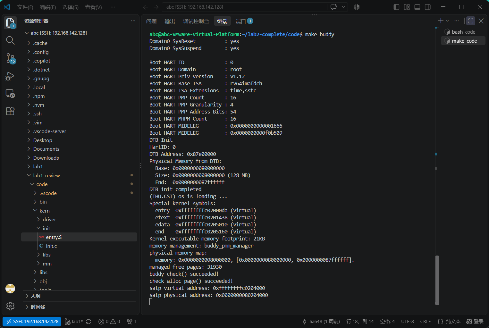
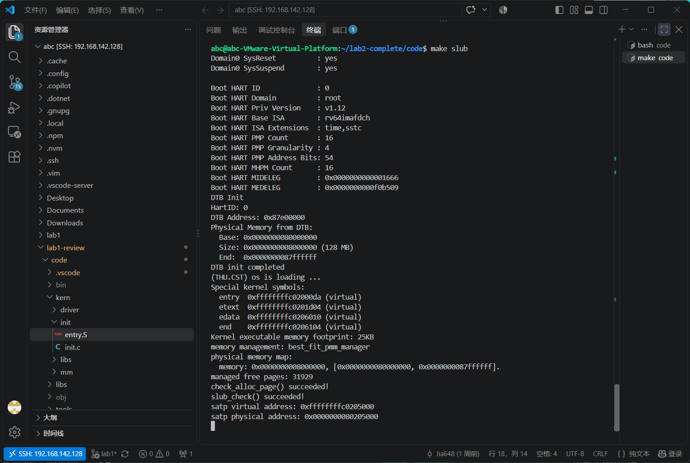
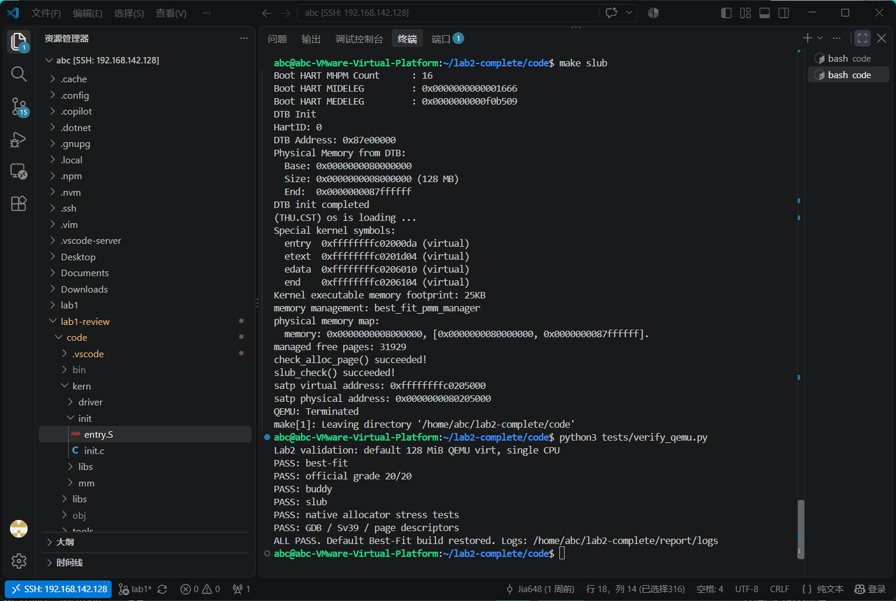
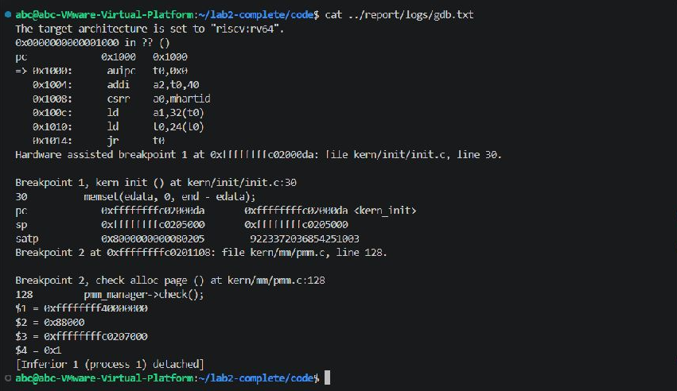

# Lab2：物理内存与页分配实验报告

| 项目 | 内容 |
|---|---|
| 小组成员 | 2413000 李亚杰、2414072 贾申奥 |
| 小组分工 | 两人共同完成代码、测试和报告整理 |
| 完成日期 | 2026-10-19 |

## 一、实验目的

1. 理解物理地址、虚拟地址和页描述符之间的关系。
2. 完成物理内存初始化，掌握连续物理页的分配与回收。
3. 比较 First-Fit、Best-Fit 和 Buddy，实现简化的 SLUB 对象分配。
4. 使用 QEMU 和 GDB 检查运行结果。

## 二、实验环境及 AI 协作

| 项目 | 使用环境 |
|---|---|
| 系统 | Windows + VMware，Ubuntu 虚拟机 |
| 交叉编译器 | riscv64-unknown-elf-gcc 13.2.0 |
| 模拟器 | QEMU 8.2.2，OpenSBI 1.3 |
| 调试器 | gdb-multiarch 15.0.50 |
| 开发工具 | VS Code Remote-SSH、Git |
| AI 工具 | Claude Code + DeepSeek API |
| 底层模型 | DeepSeek V4 |

实验中使用 AI 辅助分析代码、实现算法和设计测试，再通过编译、运行和调试检查结果。各任务的提示词整理在 [prompt.md](prompt.md) 中。

## 三、实验整体思路

Lab1 主要完成内核启动和输出，Lab2 开始管理物理内存。程序首先建立启动页表，再读取设备树中的内存信息，为物理页建立 `Page` 描述符，将可用页面加入空闲链表，最后完成分配和释放。

主要调用顺序为：

```text
kern_entry → kern_init → dtb_init → pmm_init
→ init_pmm_manager → page_init → init_memmap
→ alloc_pages / free_pages
```

我们先完成初始化，再实现 Best-Fit，之后加入 Buddy 和 SLUB，并分别测试。

## 四、实验内容与实现

### 4.1 物理内存初始化

主要函数是 `kern/mm/pmm.c` 中的 `page_init()`。

这个函数通过 `get_memory_base()` 和 `get_memory_size()` 获取物理内存范围，设置虚实地址偏移 `va_pa_offset`，并计算管理上界 `npage`。这里的 `npage` 是物理页号上界，总页数需要用 `npage - nbase` 计算。

`pages` 数组放在内核结束地址 `end` 之后，并按页对齐。初始化时先将页面标记为保留，排除 OpenSBI、内核和描述符数组占用的空间，再把剩余完整页面交给 `init_memmap()`。本次 QEMU 提供 128 MiB 内存，默认模式初始化后有 31929 个空闲页。

需要区分的是：虚拟地址是内核使用的地址，物理地址是页面在物理内存中的地址，物理页号是物理地址除以页大小，而 `Page*` 指向对应页面的描述符。

### 4.2 First-Fit 分析

参考 `default_pmm.c`，First-Fit 的主要流程如下：

- `default_init()`：初始化空闲链表和空闲页计数。
- `default_init_memmap()`：设置可用页面的状态，将空闲块加入链表。
- `default_alloc_pages()`：从链表头开始，找到第一个足够大的块；如果有剩余页面，就分割出余块。
- `default_free_pages()`：将回收块按地址插入链表，再判断前后块是否连续，连续时进行合并。

First-Fit 实现比较简单，但空闲块较多时查找会变慢。可以考虑使用 Next-Fit 游标或按大小分类的空闲表，减少查找范围。

### 4.3 Best-Fit 实现

Best-Fit 位于 `best_fit_pmm.c`。它会遍历所有空闲块，选出能够满足申请的最小块；长度相同时选择地址较低的块。

分配时，将选中的块移出链表，把余块放回原位置，并减少空闲页计数。释放时按地址插入，分别检查前后相邻块，满足连续条件就合并。空闲块头使用 `property` 记录页数，`PageProperty` 标记它是否为有效的空闲块头。

完成后，在 `init_pmm_manager()` 中选择 `best_fit_pmm_manager` 作为默认管理器。原来的 `basic_check()` 和 `best_fit_check()` 用于检查分配、回收和合并结果。

Best-Fit 每次都要遍历链表，可以增加按大小组织的索引来提高查找速度。同时，它也可能留下较小的碎片。

### 4.4 Buddy System

Buddy 位于 `buddy_pmm.c`，使用不同阶的空闲链表管理大小为 2 的幂的块。

申请时，先将请求页数向上取整到 2 的幂，再从对应阶或更高阶中取块。如果块较大，就逐级拆分，将另一半放回空闲链表。例如申请 3 页时，实际分配 4 页。

释放时，通过 `pfn XOR (1 << order)` 计算伙伴页号。只有同阶且空闲的伙伴才能合并，合并后继续向上检查。本实现用块头的 `Page.ref` 保存阶数标记。

测试包括非 2 的幂请求、块拆分、交错释放、空闲页数恢复和对齐检查。另外进行了 2048 页全部分配、释放后重新申请整块的测试。

### 4.5 简化 SLUB

SLUB 位于 `slub.c`，提供 `kmalloc()` 和 `kfree()`。底层通过页分配器取得页面，上层将页面划分为小对象。

对象大小分为 16、32、64、128、256、512、1024、2048 字节几个等级。每个 slab 页保存对象大小、使用数量和位图。申请时优先使用已有空位，没有空位时再申请新页；当一页中的对象全部释放后，将该页归还页分配器。较大的对象直接按所需页数申请连续页面。

测试覆盖大小类边界、大对象、地址对齐和对象内容校验。还连续申请了 300 个小对象，再交错释放并重新分配，检查空位复用和页面回收。

## 五、实现过程中遇到的问题

### 5.1 开启分页后的地址衔接

初始启动页表只有高地址映射。我们补充了低地址恒等映射，让设置 `satp` 后的指令可以继续执行，再跳转到高地址的 C 入口。

### 5.2 QEMU 启动方式

沿用 Lab1 的处理，使用 `-kernel` 加载内核镜像，并将调试器设置为 `gdb-multiarch`。

### 5.3 测试结果判断

自动验证脚本一开始把编译输出中的文件名 `panic.c` 当成了内核错误。后来改为检查 `kernel panic at`，重新执行完整测试后通过。

## 六、测试与验证

### 6.1 Best-Fit 启动

执行 `make clean && make qemu`，输出 `best_fit_pmm_manager` 和 `check_alloc_page() succeeded!`。



### 6.2 课程评分

执行 `make grade`，两项检查均为 OK，总分为 20/20。



### 6.3 Buddy 测试

执行 `make buddy`，输出 `buddy_check() succeeded!`。



### 6.4 SLUB 测试

执行 `make slub`，输出 `slub_check() succeeded!`。



### 6.5 完整测试

执行 `python3 tests/verify_qemu.py`，Best-Fit、课程评分、Buddy、SLUB、压力测试和内核 GDB 检查均通过，最后输出 `ALL PASS`。



### 6.6 GDB 检查

通过 GDB 检查了内核入口、`satp` 和页描述符。记录中 `satp` 为 `0x8000000000080205`，采用 Sv39；`va_pa_offset` 为 `0xffffffff40000000`，`npage` 为 `0x88000`。

下图为保存的 GDB 日志在终端中的显示，完整输出见 `logs/gdb.txt`。



## 七、思考题

### 如何获取硬件的可用物理内存范围？

本实验通过设备树获取内存起点和大小。其他平台也可以使用固件提供的内存地图，例如 UEFI 的内存信息或 BIOS E820。获取范围后，还要排除固件、内核和设备保留区，才能加入空闲内存。

### First-Fit 和 Best-Fit 有什么区别？

First-Fit 选择第一个足够大的块，Best-Fit 选择最小的可满足块。例如空闲块依次为 5、2、7 页，申请 2 页时，First-Fit 从 5 页块分配，Best-Fit 直接取 2 页块。

### 测试为什么要检查释放后的空闲页数？

分配成功并不能说明回收正确。释放全部对象后，如果空闲页数不能恢复，可能存在没有归还的页；如果计数多于原值，则可能重复回收。结合地址不重叠和数据校验，可以检查更多分配错误。

## 八、实验总结

通过本次实验，我们理解了物理页如何通过 `Page` 描述符和空闲链表进行管理，也熟悉了页面分配、分割、释放和合并的过程。First-Fit 和 Best-Fit 的区别主要在块的选择方式，Buddy 按 2 的幂拆分合并，SLUB 则在页分配之上管理小对象。

这些内容对应 OS 原理中的物理内存管理、地址转换和内存碎片。Sv39 页表负责地址转换，分配器负责决定哪些物理页可以使用。本实验还没有涉及进程调度、用户地址空间、换页和文件系统等内容。

使用 AI 辅助时，需要先说明函数接口和分配规则，再通过测试检查生成的代码。我们体会到，除了看程序能否编译运行，还要关注分配策略、释放后的计数以及边界情况。
