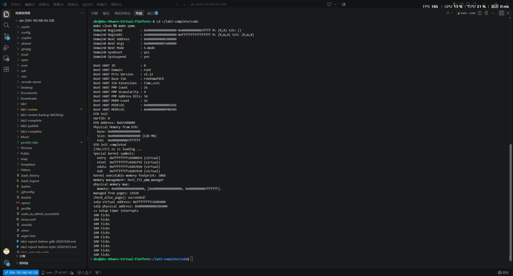
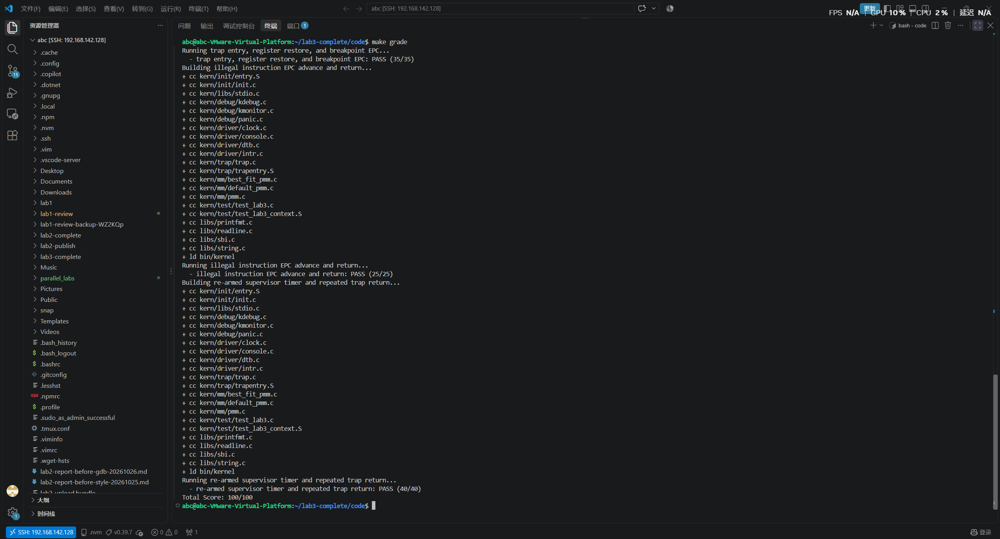
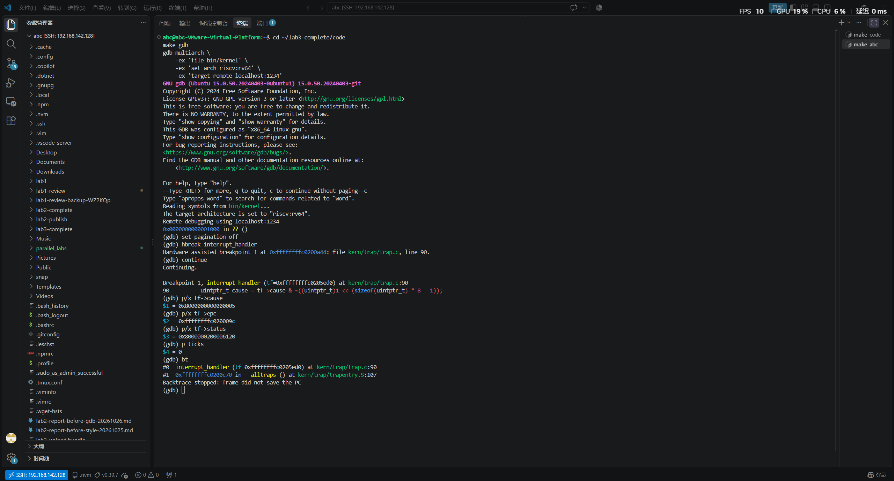
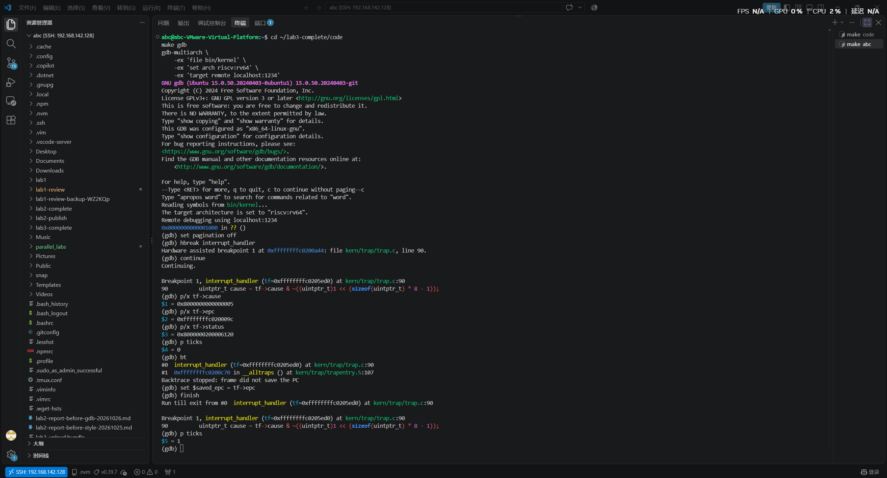

# Lab3 中断与异常实验报告

| 项目 | 内容 |
|---|---|
| 小组成员 | 2413000 李亚杰、2414072 贾申奥 |
| 分工 | 两人共同完成实现、测试与报告整理 |
| 日期 | 2026-10-30 |

## 一、实验目的

理解 RISC-V Trap 的进入与返回过程，完成寄存器恢复、中断处理和异常处理。本次按老师通知完成必做内容，不包含旧版 Challenge。

## 二、实验环境

Windows、VMware Ubuntu、RISC-V 交叉编译器、QEMU 和 gdb-multiarch。

## 三、整体思路

程序通过 stvec 设置 Trap 入口。发生中断或异常时，处理器跳到 __alltraps，SAVE_ALL 将寄存器和相关 CSR 保存到栈上的 trapframe。汇编入口把栈指针放入 a0，调用 trap。C 函数根据 scause 区分中断和异常，处理后返回汇编，通过 RESTORE_ALL 恢复上下文，最后执行 sret。

## 四、代码实现

### 4.1 上下文恢复与入口

在 kern/trap/trapentry.S 中，RESTORE_ALL 按 SAVE_ALL 的布局恢复 sstatus、sepc 和通用寄存器。x2 保存的是被打断时的栈指针，所以最后恢复 sp，避免提前丢失 trapframe 的位置。__alltraps 使用 mv a0, sp 传递参数，再调用 trap。

### 4.2 时钟中断

在 kern/trap/trap.c 的 interrupt_handler 中，收到 S 模式时钟中断后，先设置下一次事件，再将 ticks 加一。每累计 100 次打印一次 100 ticks，默认打印 10 次后调用 sbi_shutdown 关机。中断处理不修改 epc。

### 4.3 异常处理

非法指令和断点异常分别输出发生位置。读取指令低 16 位，低两位不是 11 时按 2 字节指令处理，否则按本实验使用的 4 字节指令处理。更新 tf->epc 后返回，避免反复触发同一异常。其他异常打印 trapframe。

### 4.4 Lab2 代码迁入

补入物理页初始化和 Best-Fit，保留 Lab3 在页分配接口中的中断保护。启动页表增加低地址恒等映射，使开启分页后能继续执行，再转到高地址入口。SBI 调用使用固定寄存器约束，并保留关机接口。

## 五、测试

### 5.1 时钟中断运行结果

执行 `make clean && make qemu`，物理页检查通过。时钟初始化后输出 10 次 `100 ticks`，随后自动关机，返回终端提示符。

### 5.2 课程评分

执行 `make grade`，上下文恢复与断点返回、非法指令返回、连续时钟中断三项测试全部通过，总分为 100/100。

### 5.3 GDB 查看时钟中断

分别执行 `make debug` 和 `make gdb`，在 `interrupt_handler` 设置断点。第一次命中时，`tf->cause` 为 `0x8000000000000005`，表示 S 模式时钟中断，此时 `ticks=0`。调用栈显示程序由 `__alltraps` 进入处理函数。

继续执行后再次命中中断处理入口，此时 `ticks=1`，说明前一次中断完成计数，并且下一次时钟中断已触发。

完整运行日志见 `logs/grade.txt` 和 `logs/boot.txt`。

## 六、思考与总结

硬件负责保存返回位置和 Trap 原因，但不会自动保存全部通用寄存器，因此需要汇编入口保存上下文。sp 要最后恢复；异常跳过触发指令，而时钟中断应返回原执行位置。时钟必须重新设置下一次事件，才能持续触发。

通过本实验，我们把 Trap 入口、C 处理函数和返回指令连成了完整过程，也理解了中断与同步异常在返回位置处理上的区别。
