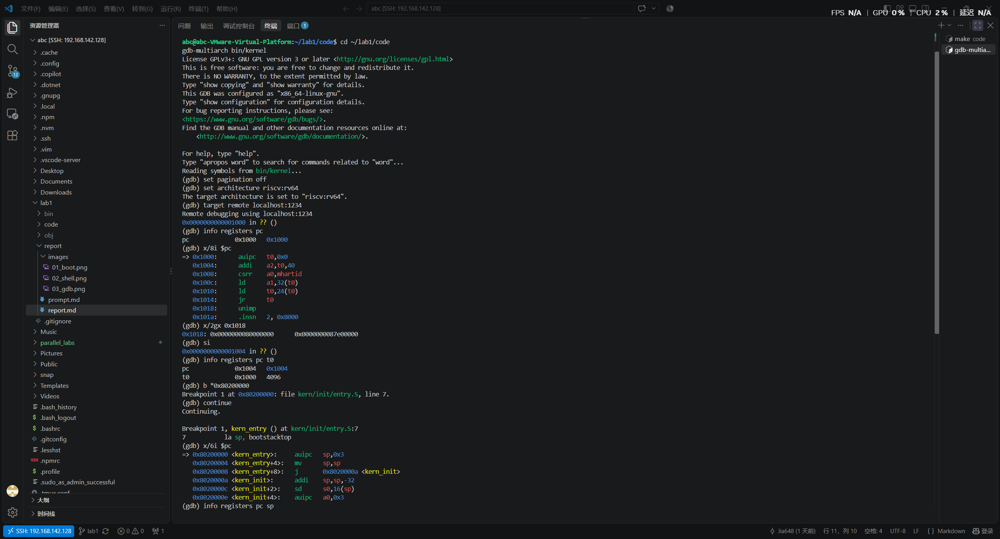
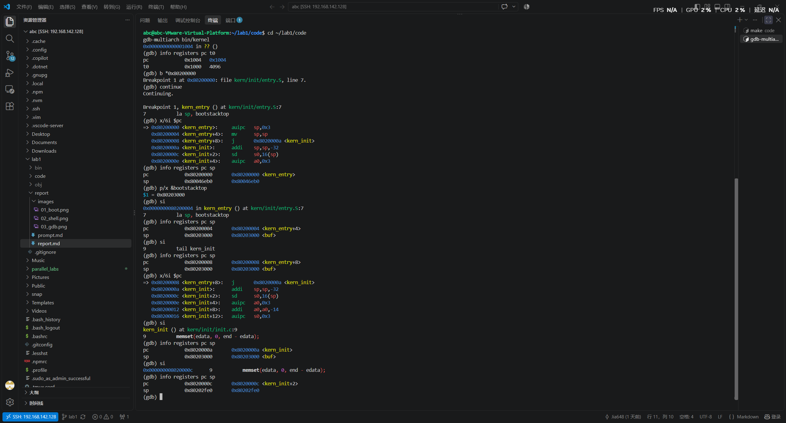
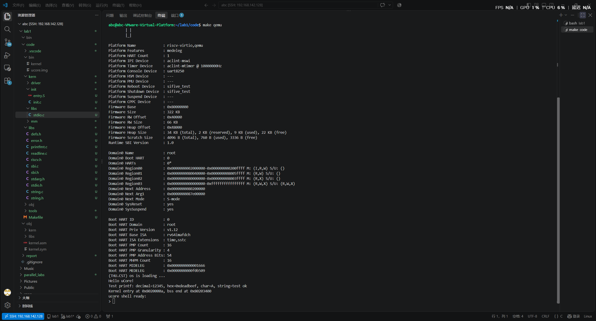
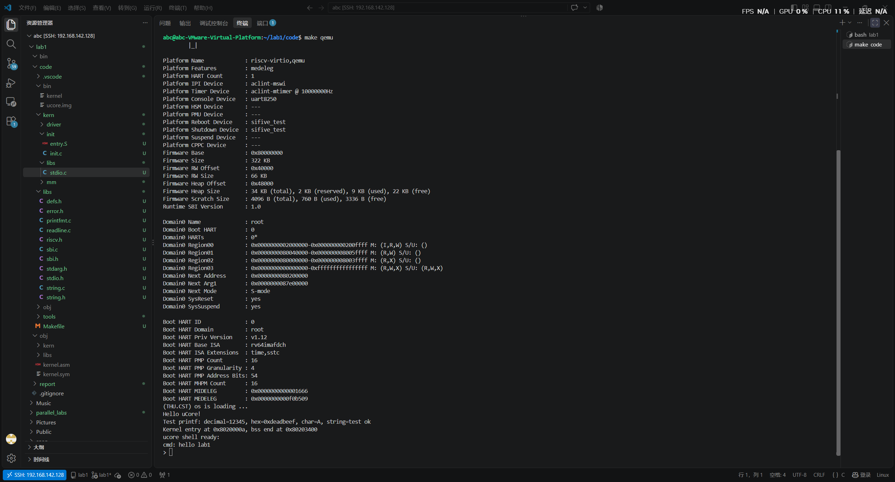
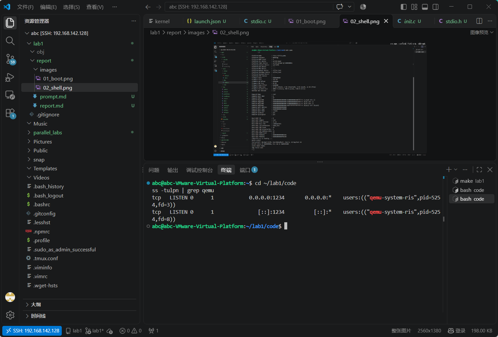
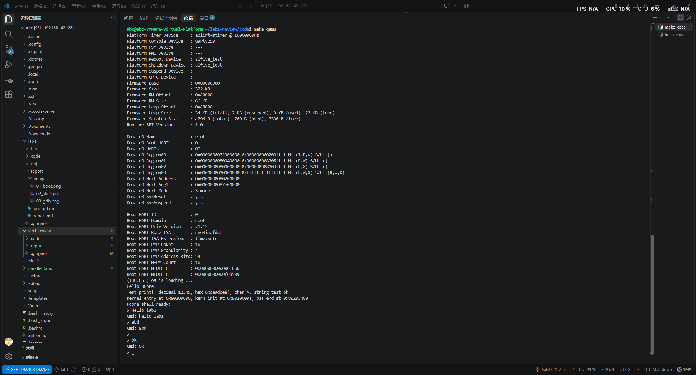

# 操作系统 Lab1 最小可执行内核实验报告

| 项目 | 内容 |
|---|---|
| 实验名称 | Lab1：最小可执行内核 |
| 小组成员 | 2413000-李亚杰、2414072-贾申奥 |
| 完成日期 | 2026-10-10（原实验完成日期） |
| 分工 | 两位成员共同完成，未明确划分练习或模块；不追溯编造独立分工 |

| 成员 | AI 编程工具 | 底层模型 |
|---|---|---|
| 小组共同使用 | Claude Code，通过 DeepSeek API 调用 | DeepSeek V4（小组提供名称，精确 API 模型 ID 未记录） |

> 本文包含 2026-10-11 的检查补充。原有截图对应补充前的版本；补充后的代码已于 2026-10-11 在 Ubuntu 中完成干净构建并成功启动；基本输入、退格与空行已提供复测截图；补充版本的 GDB 入口与栈初始化复测通过。超长输入未做运行验证。

## 一、实验目的
1.  搭建RISC-V架构操作系统开发环境，熟悉交叉编译、QEMU模拟器的使用
2.  理解RISC-V平台从机器加电到内核运行的完整启动流程
3.  实现最小可执行uCore内核，完成内核栈初始化、BSS段清零、控制台格式化输出、键盘输入和简单交互式Shell
4.  体验GDB远程调试流程，理解OpenSBI和SBI调用的作用

## 二、实验环境
- 主机环境：Windows 11 + VMware Workstation
- 虚拟机系统：Ubuntu 24.04 LTS（虚拟机名称：操作系统）
- 交叉编译工具链：riscv64-unknown-elf-gcc 13.2.0
- 模拟器：QEMU 8.2.2 (qemu-system-riscv64)
- 调试器：gdb-multiarch 15.0
- 开发工具：VSCode Remote-SSH、Git
- AI辅助环境：Claude Code + DeepSeek API

## 三、实验内容与实现步骤

### 3.1 开发环境搭建
1.  通过apt安装基础编译工具git、build-essential、curl、wget
2.  通过Gitee镜像安装nvm，配置国内Node.js镜像，安装Node.js v22.23.3
3.  通过Ubuntu官方源安装RISC-V 64位交叉编译器`gcc-riscv64-unknown-elf`，配置`RISCV=/usr`环境变量
4.  安装QEMU RISC-V模拟器`qemu-system-misc`，验证QEMU可正常启动OpenSBI固件
5.  安装多架构GDB调试器`gdb-multiarch`

### 3.2 解决新版QEMU内核加载问题
原始 Makefile 使用 `-bios default` 配合 `-device loader` 将镜像写入 `0x80200000`。仅装入镜像不能保证固件得到正确的下一阶段跳转地址；小组在当前环境中通过改用 `-kernel` 解决启动问题。未保留修改前的完整日志，因此不把“所有新版 OpenSBI 默认跳转地址均为 0”作为结论。

修改Makefile中QEMU启动参数，使用`-kernel $(UCOREIMG)`参数直接加载内核镜像，QEMU会自动告知OpenSBI内核入口地址，OpenSBI完成初始化后正确跳转到内核入口点。

### 3.3 内核启动流程实现
内核入口为`kern/init/entry.S`：
1.  `kern_entry`入口点首先将栈指针寄存器`sp`设置为预先在内核数据段分配的引导栈顶部`bootstacktop`
2.  使用尾指令`tail kern_init`直接跳转到C语言编写的内核主函数，不需要返回
3.  C函数`kern_init`首先获取链接脚本定义的`edata`（数据段结束，BSS段开始）和`end`（BSS段结束）符号，调用`memset`将整个BSS段清零，保证所有未初始化全局变量的初始值为0

### 3.4 SBI控制台输入输出实现
SBI（Supervisor Binary Interface）是RISC-V S模式内核和M模式运行的固件之间的标准调用接口，通过`ecall`指令陷入M级固件完成底层操作：
1.  实现统一的`sbi_call`汇编包装函数：将SBI调用号放入x17(a7)寄存器，参数依次放入x10-x12(a0-a2)寄存器，执行`ecall`指令触发环境调用，返回后从x10(a0)取出返回值
2.  实现`sbi_console_putchar`：调用SBI号1，将字符输出到串口控制台
3.  实现`sbi_console_getchar`：调用SBI号2，从控制台读取输入字符，无输入时返回-1
4.  封装高层控制台驱动`cons_putc`和`cons_getc`，对接标准输入输出库

### 3.5 格式化输出与交互式Shell
1.  基于vprintfmt实现完整的`cprintf`格式化输出，支持`%d`十进制、`%x`十六进制、`%c`字符、`%s`字符串等格式
2.  修正`getchar`等待逻辑：无输入时SBI返回-1，循环等待直到返回值>=0，避免将无输入状态当成字符或错误反复返回；等待期间仍采用忙轮询
3.  实现`readline`行编辑函数：逐字符读取输入，自动回显，支持退格编辑，按下回车后返回完整的一行字符串
4.  实现最小Shell循环：打印`>`提示符，读取用户输入行，非空时回显命令内容，重新等待下一次输入

### 3.6 GDB调试体验
1.  Makefile的debug目标在正常QEMU参数后添加`-s -S`参数：
    - `-s`参数等价于`-gdb tcp::1234`，让QEMU启动后在1234端口监听GDB远程连接
    - `-S`参数让QEMU启动后立刻冻结所有CPU，在调试器连接并发送继续命令前不执行任何指令
2.  启动`make debug`后，通过`ss -tulpn`确认QEMU已经在`0.0.0.0:1234`正常监听调试端口
3.  尝试使用gdb-multiarch加载内核符号表连接QEMU，理解远程调试的工作方式：调试器运行在主机，通过TCP网络控制模拟器内的CPU执行，可以设置断点、单步执行、查看寄存器和内存

## 四、实验结果
1.  执行`make`成功编译生成ELF内核和裸二进制镜像`bin/ucore.img`，无编译错误
2.  执行`make qemu`成功启动：OpenSBI正常完成硬件初始化，正确跳转到`0x80200000`内核入口
3.  内核成功打印启动信息和格式化测试内容：
    ```
    (THU.CST) os is loading ...
    Hello uCore!
    Test printf: decimal=12345, hex=0xdeadbeef, char=A, string=test ok
    Kernel entry at 0x8020000a, bss end at 0x80203400
    ucore shell ready:
    >
    ```
4.  键盘输入功能正常：逐字符按键正确回显，输入完整字符串按下回车后，内核正确读取整行并输出：
    ```
    > qqqqqqqq
    cmd: qqqqqqqq
    >
    ```
5.  系统稳定运行，原有截图中未见刷屏或崩溃，支持持续输入命令
6.  GDB调试模式正常监听1234端口，启动即冻结CPU，符合远程调试预期

## 五、思考题解答

### 1. 从机器加电到内核运行的完整启动流程
1.  QEMU启动时首先模拟RISC-V硬件，CPU默认进入最高权限的M（Machine）模式，从内置的ROM地址开始执行，加载内置的OpenSBI固件
2.  OpenSBI在M模式运行，完成最底层硬件初始化：配置中断、定时器、串口、PMP物理内存保护，设置S模式运行环境
3.  QEMU根据`-kernel`参数将内核镜像装入物理内存，并通过固件交接信息提供下一阶段地址；OpenSBI完成初始化后向内核移交控制权
4.  OpenSBI切换CPU权限到S（Supervisor）模式，跳转到内核入口`kern_entry`
5.  内核入口汇编代码设置好C语言运行需要的栈空间，跳转到C主函数`kern_init`
6.  内核清零BSS段，初始化控制台，开始执行内核逻辑，启动完成

### 2. OpenSBI的作用是什么？
OpenSBI是RISC-V平台的M模式固件，运行在比操作系统内核更高的权限级，作用包括：
- 完成机器模式下的底层硬件初始化，为操作系统提供统一的硬件抽象，不同厂商的RISC-V硬件都可以通过标准SBI接口提供一致的操作
- 提供S模式内核可以调用的底层服务，比如串口输入输出、定时器设置、核间中断、系统关机重启，内核不需要直接操作硬件寄存器，也不需要运行在最高权限
- 完成CPU权限级切换，在M和S模式之间传递控制，配置PMP内存保护隔离M模式固件和S模式操作系统
- 提供固件交接机制，在当前 QEMU 启动方式下跳转到由 QEMU 加载的操作系统内核

### 3. 为什么内核被加载到0x80200000地址？
RISC-V QEMU virt平台的物理内存布局规定：
- 物理内存从`0x80000000`地址开始映射，前2MB（`0x80000000`到`0x80200000`）预留给OpenSBI固件和引导数据使用
- 内核从`0x80200000`开始加载，既不会和固件内存冲突，也符合RISC-V内核的标准加载地址约定
- 这个地址在链接脚本`tools/kernel.ld`中通过`BASE_ADDRESS = 0x80200000`指定，编译时所有代码和数据的符号地址都基于这个基地址计算，必须和实际加载地址一致才能正确运行

### 4. SBI调用和ecall指令的工作原理
SBI调用是RISC-V标准的环境调用机制：
1.  运行在S模式的内核按照SBI调用约定，将调用号放入a7(x17)寄存器，调用参数依次放入a0(x10)、a1(x11)、a2(x12)寄存器
2.  执行`ecall`（Environment Call）指令，该指令会主动触发异常陷阱，CPU从S模式陷入更高权限的M模式，跳转到OpenSBI预先设置的异常入口
3.  OpenSBI读取调用号和参数，在内核无法直接访问的M模式执行对应的底层硬件操作（比如写串口、设置定时器）
4.  操作完成后OpenSBI将返回值放入a0寄存器，执行异常返回指令，CPU切回S模式，内核代码继续执行，从a0取出调用结果

### 5. 内核镜像中各个段的作用
链接脚本将内核分为多个标准段：
- `.text`段：代码段，存放所有可执行的机器指令，包括入口汇编和C函数编译出的代码，属性为只读可执行
- `.rodata`段：只读数据段，存放字符串常量、const常量等运行过程中不会修改的数据，属性为只读
- `.data`段：已初始化数据段，存放初始值非0的全局变量和静态变量，加载时需要从镜像中复制初始值，属性为可读写
- `.bss`段：未初始化数据段，存放没有显式初始化的全局/静态变量，镜像不占用存储空间，内核启动时统一清零为0，属性为可读写
- 引导栈：在BSS附近预留的连续内存空间，作为C函数运行时的调用栈，用于保存函数返回地址、局部变量、寄存器上下文

### 6. 为什么需要交叉编译？
我们开发和编译内核的机器是x86_64架构的PC，而我们要运行内核的目标平台是RISC-V 64位架构，两种架构的CPU指令集完全不同，普通x86 gcc编译出的程序无法在RISC-V平台运行。交叉编译器就是运行在x86主机上、但是生成RISC-V目标架构机器码的编译工具链，它让我们可以在普通PC上编译出能在QEMU模拟的RISC-V硬件上运行的内核。

## 六、实验总结

### 实验整体逻辑与核心函数

本实验围绕“为 C 内核建立最低限度的运行环境”展开。交叉编译器首先把源代码转为 RISC-V 指令，链接脚本确定各段地址，QEMU 装入镜像，OpenSBI 完成机器模式初始化并把控制权交给 S 模式入口。入口建立栈后才能安全执行 C 函数；随后清零 BSS，使用 SBI 控制台服务观察执行结果。输入、行编辑和回显循环用于进一步验证控制台功能，属于小组增加的演示功能。GDB 则用于直接观察启动链条，验证文字分析。

| 模块 | 核心函数或符号 | 作用及依赖 |
|---|---|---|
| 入口 | `kern_entry`、`bootstacktop` | 初始化栈并跳转到 C 入口；栈在 `.data` 中分配，大小为两页，共 8192 字节 |
| 初始化 | `int kern_init(void)` | 依据链接符号 `edata`、`end` 清零 BSS，输出信息并进入回显循环 |
| 固件接口 | `sbi_call`、`sbi_console_putchar`、`sbi_console_getchar` | 按 legacy SBI 约定准备寄存器并执行 `ecall`；控制台输入无字符时返回 -1 |
| 控制台 | `cons_putc`、`cons_getc` | 将高层输入输出转交 SBI；本实验的 `cons_init` 为空，入口未调用它 |
| 格式化输出 | `cprintf`、`vcprintf`、`vprintfmt` | 展开可变参数并逐字符输出；指针格式使用 `%p` |
| 行输入 | `getchar`、`readline` | 忙轮询等待字符，以静态 1024 字节缓冲区存储一行，最多保留 1023 字节及结束符 |

### 练习 1：入口指令的作用与目的

`la sp, bootstacktop` 是加载地址的伪指令，把预留引导栈顶部的地址放入 `sp`，并非把该地址处的内存内容读入寄存器。RISC-V 栈向低地址增长，从顶部开始可使用下面的 8192 字节空间。C 函数需要通过栈保存局部变量、寄存器和调用上下文，因此必须先建立栈。

`tail kern_init` 是尾调用伪指令，转移到 `kern_init` 而不建立新的返回地址；它并不是源码中某一条固定机器指令，实际展开应通过反汇编观察。内核初始化函数被声明为不返回，最终进入无限循环，因此入口不需要返回到固件。

### 练习 2：GDB 验证启动流程

2026-10-11，小组在 Ubuntu 虚拟机的 `~/lab1/code` 中运行 `make debug`，使用 GDB 15.0.50 加载 `bin/kernel` 并连接 `localhost:1234`。以下记录来自小组提供的实际终端输出，对应虚拟机原版本，不代表本次补充代码已经通过复测。原 `03_gdb.png` 仅证明端口监听；本节文字输出补充了启动跟踪证据。

连接后 `pc = 0x1000`，复位 ROM 的反汇编为：

```text
0x1000: auipc t0,0x0
0x1004: addi  a2,t0,40
0x1008: csrr  a0,mhartid
0x100c: ld    a1,32(t0)
0x1010: ld    t0,24(t0)
0x1014: jr    t0
```

`auipc` 建立基址 `t0 = 0x1000`，`addi` 使 `a2` 指向 `0x1028` 的固件交接数据，`csrr` 将 hart ID 放入 `a0`。`x/2gx 0x1018` 读到 `0x80000000` 和 `0x87e00000`：前者由 `ld t0,24(t0)` 读取作为固件跳转地址，后者由 `ld a1,32(t0)` 读取作为设备树地址。最后 `jr t0` 转移到固件。`x/8i` 在 `0x1018` 后显示的 `unimp` 等是将数据当成指令解码的结果，不是本启动路径继续执行的指令。

执行一次 `si` 后，观察到 `pc = 0x1004`、`t0 = 0x1000`，与第一条指令的分析一致。随后设置 `b *0x80200000` 并执行 `continue`，成功命中 `kern_entry`，此时 `pc = 0x80200000`、`sp = 0x80046eb0`。这验证了执行从复位阶段继续运行后到达内核入口；本次没有逐条跟踪 OpenSBI 的全部内部初始化过程。

入口反汇编及单步结果如下：

```text
0x80200000 <kern_entry>:   auipc sp,0x3
0x80200004 <kern_entry+4>: mv    sp,sp
0x80200008 <kern_entry+8>: j     0x8020000a <kern_init>
0x8020000a <kern_init>:    addi  sp,sp,-32

p/x &bootstacktop: 0x80203000
第一次 si 后：pc = 0x80200004，sp = 0x80203000
第二次 si 后：pc = 0x80200008，sp = 0x80203000
```

本构建中 `la sp, bootstacktop` 展开为两条指令，第二条的地址修正为零，因此第一条执行后 `sp` 就已经等于栈顶部。GDB 将该地址同时标注为 `<buf>`，因为 BSS 缓冲区起点与栈顶边界地址相同；栈向低地址增长，缓冲区位于该边界上方，不表示两块空间重叠。`tail kern_init` 在本构建中展开为直接跳转 `j`，目标为 `0x8020000a`，不设置新的返回地址。继续一次 `si` 后，`pc = 0x8020000a <kern_init>`，`sp` 仍为 `0x80203000`，验证尾跳转进入 C 函数。再执行一次 `si` 后，`pc = 0x8020000c`、`sp = 0x80202fe0`，比原栈顶减少 32 字节，与函数序言 `addi sp,sp,-32` 一致。GDB 此时显示 `memset` 的源代码行，是调试行号映射，不表示 BSS 清零已经执行完毕。

原理分析：QEMU virt 的复位入口通常在 `0x1000`，其 ROM 指令准备 hart ID、设备树地址等交接信息并转移到固件入口；OpenSBI 在 M 模式初始化后转移到 S 模式内核。具体指令及寄存器值必须以本次调试输出为准。采用 `-kernel` 时，镜像由 QEMU 在 CPU 执行前装入，因此事后设置 `watch *0x80200000` 不一定能观察到装入动作，不能把 watchpoint 未命中当作加载失败。





### 测试证据与检查补充

以下为原实验截图，不能用来证明 2026-10-11 补充后的代码已经通过测试。







检查补充修正了 SBI 固定寄存器约束、指针输出格式、BS/DEL 退格处理及终端擦除、GDB 可配置命令。还为缺失的 `tools/grade.sh` 增加提前检查，避免 `make grade` 在报错前先清理构建结果；这不等于提供了课程评分测试。

| 验证项目 | 操作 | 当前证据 |
|---|---|---|
| 原版本启动与回显 | `make qemu`，输入文本并回车 | 原截图支持 |
| 补充版本构建 | 在 `code` 中运行 `make clean && make` | 2026-10-11 小组提供完整输出：全部源文件编译、链接及镜像生成成功，无错误 |
| 补充版本启动 | `make qemu`，观察入口地址和提示符 | 2026-10-11 输出确认入口 `0x80200000`、`kern_init` 为 `0x8020000a`、BSS 结束为 `0x80203400`，出现 Shell 提示符 |
| 退格 | 输入 `abc`，退格后输入 `d` 并回车 | 按指定步骤操作后的截图显示输入及回显均为 `abd` |
| 基本输入与空行 | `hello lab1`、空行、空提示符退格后输入 `ok`，连续多行 | 小组按指定步骤操作后提供截图：正确回显 `hello lab1` 和 `ok`，空行返回提示符并继续运行；截图本身不能显示退格按键事件 |
| 超长输入 | 超过 1023 字节的一行 | 源码限制最多保留 1023 字节；未做运行验证 |
| 补充版本 GDB | 在 `~/lab1-review/code` 运行 `make debug` 和 `make gdb`，断点及两次单步 | 2026-10-11 小组终端输出确认 `gdb-multiarch` 成功连接，初始 PC 为 `0x1000`；命中入口 `0x80200000`，两次单步后 PC 为 `0x80200008`、SP 为 `0x80203000` |
| 原版本真实启动跟踪 | GDB 连接、复位反汇编、内核入口断点及栈初始化单步 | 2026-10-11 小组终端输出已验证；已记录尾跳转进入 C 函数及函数序言分配栈空间 |

补充版本的启动与基本交互复测截图如下。截图记录 hello lab1、编辑后的 bd、空行和 ok 的连续交互结果；未将这些结果扩大为全部边界场景均通过。



### 与操作系统原理的联系

| 实验知识点 | 对应原理 | 含义、关系与差异 |
|---|---|---|
| OpenSBI 与 S 模式内核 | 特权级及保护 | 固件提供更高权限的服务；本实验未构造用户态与内核态隔离 |
| `ecall` 调用 SBI | 异常与控制转移 | 同步陷阱把执行权交给固件；与用户程序进入内核的系统调用处于不同边界 |
| 栈初始化 | 运行时与调用约定 | 栈支撑 C 调用和局部数据；当前只有引导栈，没有线程切换 |
| 链接脚本、BSS | 程序装载与内存布局 | 链接确定符号地址，启动清零未初始化数据；当前使用物理地址，未启用分页 |
| 控制台轮询 | 设备输入输出 | 从固件读取字符；无中断驱动、阻塞队列或调度，等待时仍占用 CPU |

进程与线程管理、调度、虚拟内存与页表、并发同步、文件系统、用户程序装载和系统调用等是 OS 原理的重要内容，但本实验尚未实现。当前“Shell”仅回显一行文本，没有解析命令、创建进程或执行程序。

### AI 协作与提示词记录

小组共同使用 Claude Code 与 DeepSeek V4。原始任务提示概述见 [prompt.md](./prompt.md)，未保留逐轮完整聊天记录，不能确认每个模块的迭代次数和逐字最终提示词。后续应保存具体提示、生成结果、错误输出和验证记录，使报告能够追溯。

本次检查表明：AI 生成的启动原理描述应与源码和运行日志交叉核对；端口监听只能证明调试服务存在，不能证明调试练习完成；成功截图也不能证明边界输入或不同优化条件下的正确性。补充代码后应重新验证，而不沿用旧截图作为新版本通过的证据。
本次实验完成了RISC-V操作系统开发环境搭建，实现了一个最小可执行uCore内核，理解了RISC-V特权级、启动流程、SBI调用、链接脚本和内核镜像结构等基础概念，打通了从编译、模拟启动到控制台输入输出的完整开发流程，为后续内存管理、中断处理等实验打下了基础。实验过程中也排查解决了新版QEMU加载地址、输入等待逻辑等问题，加深了对系统底层启动过程的理解。
