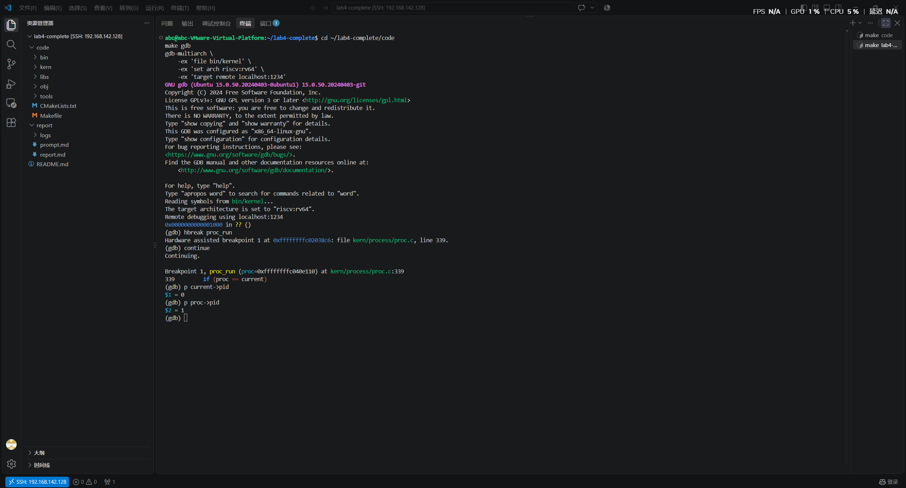
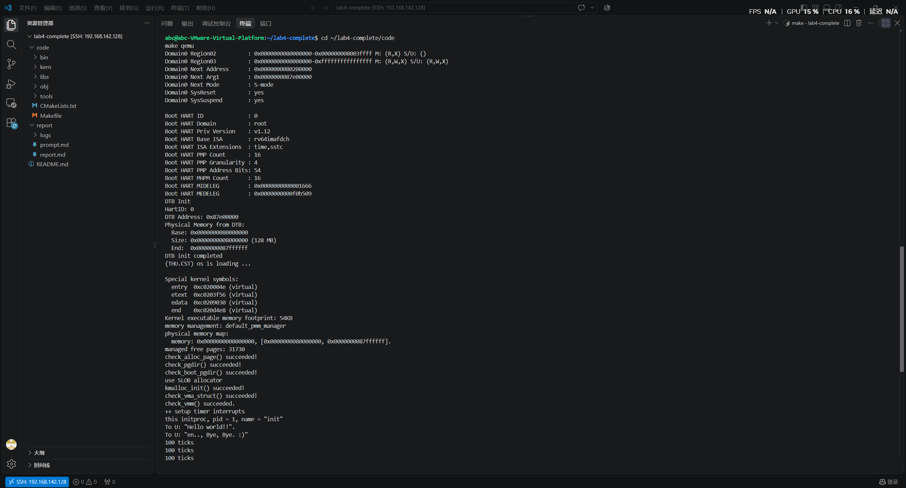
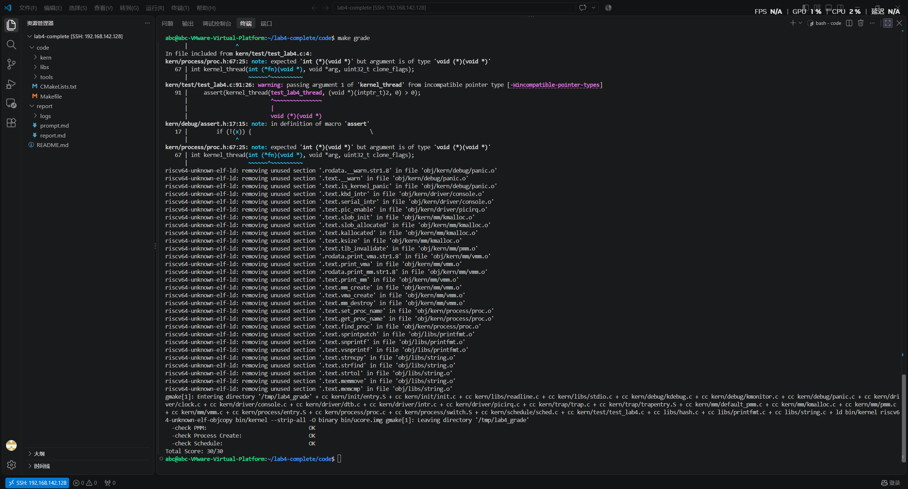

# Lab4 虚拟内存与内核线程实验报告

| 项目 | 内容 |
|---|---|
| 小组成员 | 2413000 李亚杰、2414072 贾申奥 |
| 环境 | VMware Ubuntu、RV64 交叉编译工具链、QEMU virt、OpenSBI |

## 一、实验过程

内核启动时先建立 Sv39 映射和物理内存管理，再初始化中断入口、虚拟内存和进程表。初始执行流由 idleproc 表示。proc_init 创建 initproc，随后 cpu_idle 调用 schedule，选出可运行线程，通过 proc_run 和 switch_to 开始执行新线程。

## 二、页表操作

page_insert 先用 get_pte 找到目标页表项，找不到且无法分配时返回 -E_NO_MEM。若旧项与新页相同，只更新权限并刷新该地址的 TLB，引用计数保持原值。若旧项指向另一页，先撤销旧映射并减少引用，再建立新映射。page_remove 只在目标项有效时操作，最后一个引用撤销后释放物理页。

get_pte 按 Sv39 的三级索引定位 4 KiB 页表项。创建下一级页表失败时，回收本次新分配且尚未被使用的中间页表。遇到已有大页叶项时停止向下遍历，以免把映射的数据区当成页表。

## 三、内核线程的创建

alloc_proc 分配并清零 PCB，设置初始状态和页表地址。idleproc 复用启动栈，PID 为 0。initproc 通过 kernel_thread 创建，PID 为 1。kernel_thread 在临时 trapframe 中保存入口和参数，do_fork 分配内核栈、复制现场，再登记 PID、挂入进程链表和哈希表并唤醒线程。分配失败按相反顺序清理资源。copy_mm 在本实验中保留共享内核地址空间的行为。

新线程第一次运行时，switch_to 从 context.ra 跳到 forkret，随后通过 forkrets 和 __trapret 载入 trapframe，由 sret 进入 kernel_thread_entry，最后调用线程函数。线程函数返回后，do_exit 将线程标为僵尸并让出 CPU。此阶段尚未实现父进程等待和回收僵尸资源。

## 四、调度与切换

schedule 从当前线程之后循环查找可运行线程，没有合适候选时选择 idleproc。切换前在关中断区间内更新 current 和 satp，并刷新 TLB。switch_to 按 struct context 的布局保存旧线程的 ra、sp 和 s0 至 s11，再从新线程的 context 恢复对应寄存器。

Trap 需要保存被中断代码的完整通用寄存器现场。switch_to 在普通函数调用边界发生，保存调用约定要求的寄存器，以及恢复执行所需的 ra 和 sp。

用 GDB 在 `proc_run` 入口停下时，当前线程是 `idleproc`（PID 0），调度选中的线程是 `initproc`（PID 1）。

## 五、规格、提示词与调试

三个模块的规格及用于复核的提示词见 [prompt.md](prompt.md)。

- Sv39 的模式字段在 satp 高位。切换代码将模式值 8 左移 60 位后与页表物理页号合并。
- 初次评分的串口日志为空。评分脚本读取了小写 qemu 变量并使用与旧实验相关的调试流程，改为读取 QEMU 并在有限时间内收集串口输出。课程测试用例和评分项保持原样。
- 框架原自检要求非叶目录项带 PTE_U。实际 QEMU 在访问低地址别名时发生故障。目录项改用有效位，权限放在叶项，并将对应框架断言改为检查目录项类型和 U 位。

## 六、思考题

local_intr_save 记录本核原有的中断使能状态，并在必要时关中断。local_intr_restore 按记录恢复，因此内外层临界区嵌套时，内层退出不会提前打开中断。它只保护本核执行流。

Sv32 用两个 10 位索引，Sv39 用三个 9 位索引，Sv48 用四个 9 位索引。三种模式的 4 KiB 页内偏移都是 12 位。get_pte 两段相似代码分别处理 Sv39 的两级非叶目录，过程都是查有效位、按需分配并进入下一层。把查找与分配放在一个入口便于调用者用 create 控制行为，层数变多时可用循环或独立辅助函数降低重复，并明确处理失败回滚。

本实验对应页表、TLB、PCB、线程状态与上下文切换。这里运行的是共享内核地址空间的线程，用户地址空间复制、换页、等待回收和完整抢占调度属于后续内容。

## 七、验证

运行 `make qemu` 查看页表自检和 initproc 输出，按 Ctrl+A 后按 X 退出。运行 `make grade` 检查页表操作、进程创建、调度三项。

本次 Ubuntu 虚拟机验证中，普通构建成功，QEMU 启动完成页表自检并执行 initproc，随后持续输出时钟计数。课程评分三项全部通过，总分 30/30。验证过程通过定时停止结束普通 QEMU 运行。完整输出见 [评分日志](logs/grade.txt) 和 [启动日志](logs/boot.txt)。

